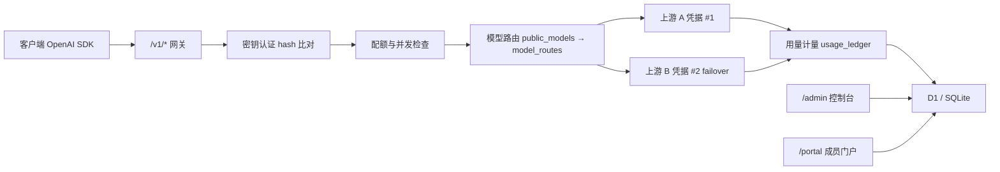

# AetherGate · AI 网关

> 一个可独立部署、OpenAI 协议兼容的 AI 网关：多上游聚合、按成员发密钥、配额与用量结算、全链路审计。
>
> A self-hostable OpenAI-compatible gateway with multi-provider routing, member-scoped API keys, quota enforcement and per-request usage settlement.

[](https://github.com/haiying-ai/aethergate-ai-gateway/actions/workflows/ci.yml)


## 解决什么问题

把一个上游 API Key 直接发给同事或朋友，就没有任何边界了：用了多少、能不能用某个模型、超额后怎么办、出了事谁在用，全都不可控。AetherGate 把这些做成网关的默认能力：

- **上游是资源池**：一个对外模型名可以路由到多个上游供应商，按优先级 + 权重分配，失败可切备用
- **成员是隔离单元**：每个成员拿到自己的 `sk-` 密钥（服务端只存哈希），有独立的 RPM / TPM / 并发 / 月预算
- **配额是硬约束**：窗口期内的请求数、Token 数、并发数、单次最大输入输出都可在策略里限定
- **账本是可对账的**：每次请求落一条 `usage_ledger`，记录上游模型、价格版本、输入输出 Token、成本与结算金额
- **凭据是加密的**：上游 Key 以 AES-GCM 加密存 D1，带 nonce 与 key version，支持轮换
- **操作是可追溯的**：管理端每次变更写入 `audit_logs`

## 对外接口

OpenAI 协议兼容，客户端改 `base_url` 与 `api_key` 即可接入：

| 方法 | 路径 | 说明 |
| --- | --- | --- |
| POST | `/v1/chat/completions` | 对话补全，支持流式 |
| POST | `/v1/responses` | Responses 协议 |
| GET | `/v1/models` | 当前密钥可见的模型列表 |
| GET | `/v1/usage` | 当前密钥的用量与配额余量 |

管理面：

| 路径 | 说明 |
| --- | --- |
| `/admin` | 控制台：供应商、模型路由、成员、邀请码、配额策略、健康事件 |
| `/portal` | 成员自助门户：密钥管理、用量查看 |
| `/api/control-plane` | 控制面 API |
| `/api/portal` | 门户 API |

## 架构



核心表（`db/schema.ts`）：

- `providers` / `provider_credentials` / `provider_models` —— 上游与凭据池
- `public_models` / `model_routes` —— 对外模型名到上游模型的映射与故障转移
- `model_price_versions` —— 带生效时间的价格版本，上游改价后历史仍可追溯
- `members` / `invitations` / `member_api_keys` / `member_model_policies` —— 成员与密钥
- `quota_policies` / `member_entitlements` —— 配额规则与邀请码附带的额度
- `concurrency_leases` —— 带过期时间的并发租约
- `usage_ledger` / `health_events` / `audit_logs` —— 用量、健康与审计

## 本地开发

要求 Node.js `>=22.13.0`，以及一个 D1（SQLite）绑定。

```bash
npm install
npm run db:generate   # 修改 db/schema.ts 后生成迁移
npm run dev           # 启动本地开发服务
npm test              # 配额策略、图片路由、用量计量、权益额度等用例
```

D1 绑定在 `.openai/hosting.json` 中声明为 `DB`，`vite.config.ts` 会在本地模拟该绑定。

## 部署

当前实现面向 OpenAI Sites / Cloudflare Workers 运行时（`worker/index.ts` 为入口，`app/chatgpt-auth.ts` 提供可选的 ChatGPT 登录）。部署到其他平台需要先替换这两处宿主适配：

1. `worker/index.ts` —— 换成目标平台的入口
2. `app/chatgpt-auth.ts` 以及读取 `oai-authenticated-user-*` 请求头的位置 —— 换成自有身份体系

这是当前最主要的移植成本，已列入 Roadmap。

## 与 new-api 的关系

本项目的接口形态与 `QuantumNous/new-api` 属于同一类产品（OpenAI 兼容的多上游中转），**但代码为独立实现**：上游是 Go，本仓库是 TypeScript + Next.js + D1，数据模型、配额与计费模型均为自行设计。因此不继承上游的 AGPL-3.0 许可。

## 已知限制

- 强绑定 Cloudflare 运行时，脱离 OpenAI Sites 需改造入口与身份层
- 无内置对外收款，`usage_ledger` 只做内部结算
- 图片接口仅做输入转发，未做独立计费
- 管理面为单管理员模型，暂不支持多角色权限

## License

[MIT](LICENSE)。上游 `QuantumNous/new-api` 的 AGPL-3.0 不适用于本仓库，理由见上方「与 new-api 的关系」。
